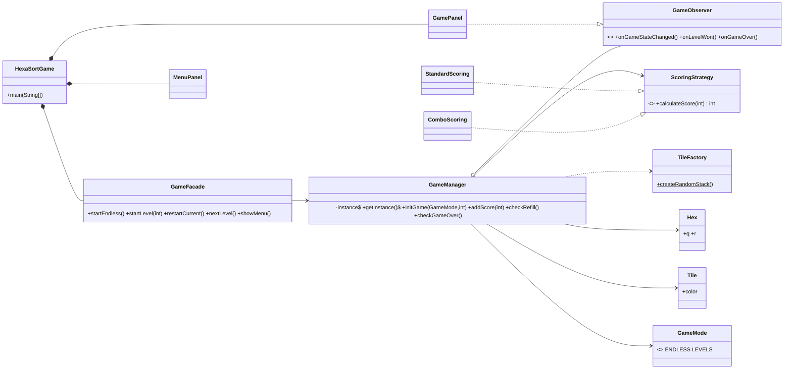

# Hexcellent


A hex-sort puzzle game written in pure Java (Swing + Java2D). Place stacks of coloured hexagonal tiles on a hex grid. Same-coloured tops merge automatically, and any run of 10+ tiles of one colour is cleared for points. No game engine and no external runtime dependencies.


## Features

- **Hexagonal grid in axial coordinates**: radius-2 board (19 cells). Hex-to-pixel projection, 6-direction neighbour lookup and polygon hit-testing are all implemented by hand.
- **Chain merges**: after a stack lands, matching tops are pulled in from neighbouring cells. The board then keeps resolving merges until it is stable.
- **Two game modes**
  - **Endless**: standard scoring, session high score, 5 hints and 3 bombs.
  - **Levels**: 10 levels with increasing target scores (500 → 30,000), combo scoring, 2 hints and 1 bomb.
- **Power-ups**
  - **Hint**: a greedy move evaluator scores every (hand stack × empty cell) placement by merges and potential clears, then highlights the best one.
  - **Bomb**: clears any occupied cell.
- **Animations**: a 60 FPS loop driven by a Swing `Timer`, smoothstep-eased tile movement and floating score popups.
- **Game flow**: menu → game → game over / level cleared → restart / next level.

## Architecture

The game logic (`logic`, `model`) is decoupled from rendering and input (`ui`), so the core rules can be unit-tested without a window.

| Pattern   | Where                                            | Purpose                                                           |
|-----------|--------------------------------------------------|-------------------------------------------------------------------|
| Singleton | `GameManager`                                    | Single source of truth for game state                             |
| Observer  | `GameObserver` ← `GamePanel`                     | UI reacts to state changes, level won and game over               |
| Strategy  | `ScoringStrategy` → `StandardScoring`, `ComboScoring` | Scoring rules swapped per game mode                         |
| Factory   | `TileFactory`                                    | Generates random single- or two-colour tile stacks                |
| Facade    | `GameFacade`                                     | One entry point for screen navigation and game lifecycle          |



A more detailed PlantUML class diagram is available in [`diagram.puml`](diagram.puml).

## Project structure

```
src/
├── main/       HexaSortGame        entry point, JFrame + CardLayout
├── ui/         GamePanel, MenuPanel, GameFacade
├── logic/      GameManager, GameObserver, TileFactory
│   └── strategies/  ScoringStrategy, StandardScoring, ComboScoring
└── model/      Hex, Tile, GameMode, AnimTile, FloatingText
test/java/      JUnit 5 tests for logic and model
```

## Running

**Requirements:** JDK 21+.

**IntelliJ IDEA:** open the folder, set a JDK 21+ SDK, then run `main.HexaSortGame`.

**Command line:**

```bash
javac -d out $(find src -name "*.java")
java -cp out main.HexaSortGame
```

## Tests

11 JUnit 5 tests cover the core rules:

- `GameManagerTest`: singleton identity, state reset for both modes, level targets and power-up counts, score and high-score updates, the level-won event when the target is reached, hand refill, and game over on a full grid.
- `ScoringStrategyTest`: standard vs combo scoring, including the combo bonus threshold.
- `TileFactoryTest`: generated stack size bounds.
- `HexTest`: `equals` / `hashCode` contract (required for use as a `HashMap` key).

Run them from IntelliJ (right-click `test/java` → *Run All Tests*) or with the JUnit console launcher:

```bash
javac -d out $(find src -name "*.java")
javac -d out -cp out:junit-platform-console-standalone.jar $(find test -name "*.java")
java -jar junit-platform-console-standalone.jar execute -cp out --scan-classpath
```

## Controls

| Action      | Input                                                 |
|-------------|-------------------------------------------------------|
| Select stack| Click a stack in the hand (bottom row)                |
| Place stack | Click an empty cell on the board                      |
| Hint        | Yellow button: highlights the best stack and cell     |
| Bomb        | Dark button, then click an occupied cell to clear it  |
| Menu        | Red button, top right                                 |

## Possible improvements

- Replace the `GameManager` singleton with dependency injection and encapsulate its public fields, so tests no longer share global state.
- Move merge and clear resolution from `GamePanel` into the logic layer to make it unit-testable.
- Add a Maven/Gradle build and a CI workflow.
- Persist the high score between sessions.

## Author

Bogdan-Andrei Cernea: [GitHub](https://github.com/CerneaBogdanAndrei) · [LinkedIn](https://linkedin.com/in/cernea-bogdan-andrei)
